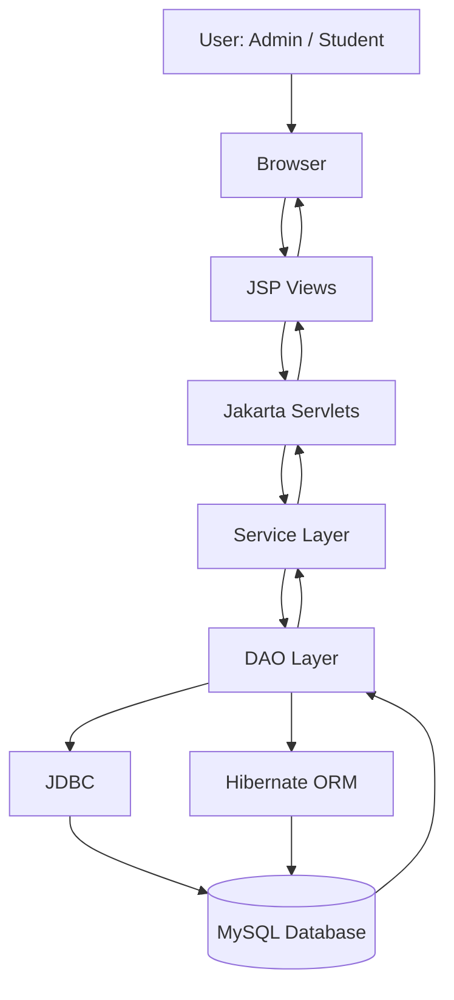

# 🏠 Hostel Parcel and Delivery Management System

\<p align="center">
&#x20; \<b>A Java-based web application for managing hostel parcel reception, tracking, and collection.\</b>
&#x20; \<br>
&#x20; Built as an MCA Mini Project using Java, Jakarta Servlets, JSP, JDBC, Hibernate, and MySQL.
\</p>

\<p align="center">
&#x20; \
&#x20; \
&#x20; \
&#x20; \
&#x20; \
&#x20; \
\</p>

---

## 📌 Table of Contents

- [📖 About the Project](#-about-the-project)
- [🎯 Project Objectives](#-project-objectives)
- [✨ Key Features](#-key-features)
- [🛠️ Technology Stack](#️-technology-stack)
- [🏗️ System Architecture](#️-system-architecture)
- [🗂️ Project Structure](#️-project-structure)
- [🗄️ Database Concepts](#️-database-concepts)
- [📚 MCA Syllabus Mapping](#-mca-syllabus-mapping)
- [⚙️ Installation and Setup](#️-installation-and-setup)
- [🔐 Demo Login Credentials](#-demo-login-credentials)
- [🧪 Testing Guide](#-testing-guide)
- [🎓 Learning Outcomes](#-learning-outcomes)
- [🚀 Future Improvements](#-future-improvements)
- [👨‍💻 Author](#-author)

---

## 📖 About the Project

The **Hostel Parcel and Delivery Management System** is a Java web application designed to make parcel management easier for college and university hostels.

In many hostels, parcels are received at the reception desk and students have to contact the receptionist to check whether their packages have arrived. Managing these records manually can become confusing, especially when many students receive parcels every day.

This project provides a centralized system where the administrator can register incoming parcels, assign them to students, and update their delivery status. Students can log in to view their parcels and track their delivery progress.

The project also demonstrates important concepts of Advanced Internet Programming and database programming through Java Servlets, JSP, JDBC, Hibernate ORM, and MySQL.

## 🎯 Project Objectives

- To develop a web-based parcel management system for hostel residents.
- To understand Java web application architecture and the MVC design pattern.
- To implement Servlets and JSP for handling client-server communication.
- To connect a Java web application with MySQL using JDBC.
- To demonstrate Hibernate ORM for database operations.
- To implement database operations using SQL queries and stored procedures.
- To understand database programming concepts such as functions, cursors, triggers, and exception handling.
- To provide separate login access for administrators and students.
- To maintain parcel delivery records and improve record management.

## ✨ Key Features

### 👨‍💼 Admin Module

| Feature             | Description                                           |
| ------------------- | ----------------------------------------------------- |
| Admin Login         | Secure login using username and password              |
| Dashboard           | View important parcel and student information         |
| Student Management  | Add, view, edit, and delete student records           |
| Parcel Registration | Register incoming parcels and assign them to students |
| Parcel Management   | View and manage registered parcels                    |
| Status Updates      | Update parcel status                                  |
| Pending Parcels     | View parcels waiting for collection                   |
| Delivered Parcels   | View delivered parcel records                         |
| Audit Log           | View recorded database changes, where configured      |

### 🎓 Student Module

| Feature         | Description                                    |
| --------------- | ---------------------------------------------- |
| Student Login   | Individual student authentication              |
| Dashboard       | View personal parcel information               |
| My Parcels      | View parcels assigned to the logged-in student |
| Parcel Tracking | Search for parcels using tracking numbers      |
| Parcel History  | View available parcel status history           |
| Profile         | View and update personal hostel information    |

### 🔒 Security Features

- Password hashing using BCrypt.
- Session management using `HttpSession`.
- Role-based access for Admin and Student.
- PreparedStatements to reduce SQL injection risks.
- Student-specific parcel access restrictions.

---

## 🛠️ Technology Stack

| Technology              | Purpose                         |
| ----------------------- | ------------------------------- |
| Java 17                 | Backend programming             |
| Jakarta Servlet API 6.1 | Request and response handling   |
| JSP                     | Dynamic web pages               |
| JDBC                    | Database connectivity           |
| Hibernate ORM 6.x       | Object-relational mapping       |
| MySQL 8.0+              | Database management             |
| Bootstrap 5             | Responsive user interface       |
| HTML and CSS            | Frontend structure and styling  |
| Apache Tomcat 11        | Web application server          |
| Apache NetBeans 31      | Development environment         |
| Apache Maven            | Dependency and build management |
| jBCrypt                 | Password hashing                |

---

## 🏗️ System Architecture

The application follows the **Model-View-Controller (MVC)** architecture with the DAO and Service patterns.



### Architecture Components

| Layer      | Responsibility                                                    |
| ---------- | ----------------------------------------------------------------- |
| Model      | Represents application entities such as Student, User, and Parcel |
| View       | Displays information through JSP pages                            |
| Controller | Handles HTTP requests through Jakarta Servlets                    |
| Service    | Contains application business logic                               |
| DAO        | Handles database operations                                       |
| Database   | Stores users, students, parcels, and related records              |

### Request Processing Flow

1. A user opens the application through a browser.
2. The browser sends an HTTP request to the web server.
3. The appropriate Servlet receives and processes the request.
4. The Servlet communicates with the DAO or Service layer.
5. The DAO interacts with MySQL using JDBC or Hibernate.
6. The result is returned to the Servlet.
7. The Servlet forwards the result to a JSP page.
8. The browser displays the updated page.

---

## 🗂️ Project Structure

```text
HostelParcelManagement/
│
├── pom.xml
├── README.md
│
├── database/
│   └── hostel_parcel.sql
│
└── src/
    └── main/
        ├── java/
        │   └── com/hostel/
        │       ├── controller/
        │       ├── dao/
        │       ├── model/
        │       ├── service/
        │       └── util/
        │
        ├── resources/
        │   └── hibernate.cfg.xml
        │
        └── webapp/
            ├── admin/
            ├── student/
            ├── css/
            ├── WEB-INF/
            ├── index.jsp
            ├── login.jsp
            └── register.jsp
```

### Important Packages

- `controller`: Contains Servlets responsible for request handling.
- `dao`: Contains database access classes.
- `model`: Contains Java entity and model classes.
- `service`: Contains business logic.
- `util`: Contains database connection, Hibernate configuration, and password utilities.

---

## 🗄️ Database Concepts

The database script is available at:

`database/hostel_parcel.sql`

The project uses MySQL to store and manage application data.

### Main Database Tables

| Table              | Purpose                                           |
| ------------------ | ------------------------------------------------- |
| `users`            | Stores login credentials and user roles           |
| `students`         | Stores student and hostel information             |
| `parcels`          | Stores parcel registration and status information |
| `delivery_history` | Stores parcel delivery events                     |
| `parcel_audit_log` | Stores database audit records                     |
| `delivery_charges` | Stores parcel handling charges, where configured  |

### Database Programming Concepts

The following MySQL features demonstrate procedural database programming concepts related to the PL/SQL portion of the MCA curriculum. Confirm that each routine exists in the supplied SQL script before relying on it as an implemented feature.

| Concept               | MySQL Implementation                       | Purpose                                     |
| --------------------- | ------------------------------------------ | ------------------------------------------- |
| Triggers              | `BEFORE INSERT` triggers                   | Validate parcel weight and handling charges |
| Explicit Cursor       | `sp_pending_parcels_cursor`                | Process pending parcel records              |
| User-Defined Function | `fn_calculate_delivery_charge()`           | Calculate parcel handling charges           |
| Stored Procedure      | `sp_register_parcel()`                     | Register a parcel through database logic    |
| Exception Handling    | `DECLARE EXIT HANDLER`                     | Handle SQL errors and rollback transactions |
| Audit Triggers        | Parcel insert, update, and delete triggers | Maintain parcel history and audit records   |

### 1. User-Defined Function

`fn_calculate_delivery_charge(p_weight)`

Calculates the handling charge based on parcel weight.

| Parcel Weight             | Handling Charge |
| ------------------------- | --------------: |
| Up to 1 kg                |             ₹20 |
| Above 1 kg and up to 5 kg |             ₹40 |
| Above 5 kg                |             ₹60 |

### 2. Stored Procedure

`sp_register_parcel()`

Demonstrates database-side parcel registration, including validation and charge calculation.

### 3. Explicit Cursor

`sp_pending_parcels_cursor(p_days)`

Processes parcels that have remained pending for a specified number of days.

### 4. Triggers

Triggers can be used to validate database entries and maintain parcel-related history and audit records.

### 5. Exception Handling

MySQL handlers and `SIGNAL SQLSTATE '45000'` can be used to handle invalid operations and database errors.

> **Academic Note:** MySQL uses its own procedural SQL language and stored-program syntax. These implementations demonstrate concepts similar to those studied in Oracle PL/SQL, but they are not Oracle PL/SQL programs.

---

## 📚 MCA Syllabus Mapping

This project combines practical concepts from **Advanced Internet Programming (AIP)** and **Database Programming / PL/SQL**.

### Advanced Internet Programming (AIP)

| AIP Concept                | Project Implementation                       |
| -------------------------- | -------------------------------------------- |
| Client-Server Architecture | Browser communicates with Tomcat server      |
| Java Web Application       | Maven-based Java web application             |
| Java Servlets              | Request processing and controller logic      |
| Servlet Lifecycle          | Servlet execution through Tomcat             |
| HTTP GET and POST          | Form submission and request handling         |
| HttpServletRequest         | Reading user input and request parameters    |
| HttpServletResponse        | Sending responses and redirects              |
| RequestDispatcher          | Forwarding requests to JSP pages, where used |
| Send Redirect              | Redirecting users after operations           |
| HttpSession                | Login sessions and role-based access         |
| JDBC                       | Connecting Java with MySQL                   |
| PreparedStatement          | Executing parameterized SQL queries          |
| Hibernate                  | ORM-based database operations                |
| MVC Architecture           | Separation of Model, View, and Controller    |

### PL/SQL and Database Programming Concepts

| Database Concept   | Project Implementation                        |
| ------------------ | --------------------------------------------- |
| SQL Queries        | Insert, update, delete, and select operations |
| Stored Procedures  | Parcel registration and pending parcel report |
| Functions          | Delivery charge calculation                   |
| Explicit Cursors   | Processing pending parcel records             |
| Triggers           | Validation and audit logging                  |
| Exception Handling | SQL handlers and transaction rollback         |
| Transactions       | Commit and rollback operations                |

---

## ⚙️ Installation and Setup

Follow these steps to run the project on your computer.

### Prerequisites

Install the following software:

- Java JDK 17 or higher
- Apache NetBeans IDE 31
- Apache Tomcat 11
- MySQL Server 8.0 or higher
- MySQL Workbench
- Apache Maven

### Step 1: Clone the Repository

After replacing `YOUR_USERNAME` with your actual GitHub username, execute:

```bash
git clone https://github.com/YOUR_USERNAME/HostelParcelManagement.git
```

Move into the project directory:

```bash
cd HostelParcelManagement
```

### Step 2: Create the Database

1. Open MySQL Workbench.
2. Open the file `database/hostel_parcel.sql`.
3. Execute the SQL script.
4. Verify that the database and tables have been created.

```sql
USE hostel_parcel_db;

SHOW TABLES;
```

**Important:** The supplied SQL script may drop and recreate the database. Do not rerun it on a database containing records you want to keep.

### Step 3: Configure Database Credentials

Update your MySQL credentials in the following files.

**JDBC Configuration**

File:

`src/main/java/com/hostel/util/DBConnection.java`

Configure the database username and password.

**Hibernate Configuration**

File:

`src/main/resources/hibernate.cfg.xml`

Update the MySQL connection properties.

Do not upload your actual database password to GitHub. Keep personal credentials out of committed source code.

### Step 4: Open the Project in NetBeans

1. Launch Apache NetBeans.
2. Select **File → Open Project**.
3. Choose the `HostelParcelManagement` folder.
4. Open the Maven Web Application.
5. Wait for Maven dependencies to load.

### Step 5: Configure Tomcat

1. Open the Services tab.
2. Right-click Servers.
3. Add Apache Tomcat 11.
4. Select Tomcat as the project runtime server.

### Step 6: Build and Run

Right-click the project and select:

**Clean and Build**

After a successful build, select:

**Run**

Open the application in your browser:

```text
http://localhost:8080/HostelParcelManagement/
```

---

## 🔐 Demo Login Credentials

The following are the original seed credentials provided for the project. They work only if the corresponding accounts exist in your database and their passwords have been initialized correctly.

| Role    | Username       | Password     |
| ------- | -------------- | ------------ |
| Admin   | `admin`        | `admin123`   |
| Student | `rahul_sharma` | `student123` |
| Student | `priya_patel`  | `student123` |
| Student | `amit_kumar`   | `student123` |

**Security Warning:** These are demonstration credentials. Change them before using the application outside a local academic environment.

---

## 🧪 Testing Guide

Use this checklist to test the main application features.

### Admin Testing

- [ ] Admin login
- [ ] View admin dashboard
- [ ] Add a new student
- [ ] Edit student details
- [ ] Delete a student
- [ ] Register a new parcel
- [ ] View all parcels
- [ ] Update parcel status
- [ ] View pending parcels
- [ ] View delivered parcels
- [ ] Check parcel audit records

### Student Testing

- [ ] Student login
- [ ] View student dashboard
- [ ] View personal parcel records
- [ ] Track a parcel using its tracking number
- [ ] View parcel history
- [ ] Update profile information
- [ ] Verify that one student cannot access another student's parcel records

### Database Testing

- [ ] Verify student records in MySQL.
- [ ] Verify parcel registration.
- [ ] Test delivery charge calculation.
- [ ] Execute the pending parcel cursor procedure.
- [ ] Test validation triggers.
- [ ] Verify transaction rollback on errors.
- [ ] Verify parcel history and audit records.

---

## 🎓 Learning Outcomes

Through this project, the following concepts were practised:

1. Understanding client-server architecture in Java web applications.
2. Creating web applications using Servlets and JSP.
3. Handling HTTP requests and responses.
4. Managing user sessions using `HttpSession`.
5. Connecting Java applications to MySQL through JDBC.
6. Performing database operations using Hibernate ORM.
7. Understanding the MVC and DAO design patterns.
8. Learning about stored procedures, functions, cursors, and triggers in MySQL.
9. Applying validation and exception handling.
10. Understanding role-based access and basic web application security.

---

## 🚀 Future Improvements

The project can be extended with additional features such as:

- Email or SMS notifications when parcels arrive.
- QR code-based parcel collection.
- Digital confirmation of parcel collection.
- Advanced parcel search and filtering.
- Downloadable reports in PDF or Excel format.
- Improved audit history and activity reports.
- Deployment on a cloud hosting platform.

---

## 👨‍💻 Author

**Aman Thakur**

26MCI10276
MCA(AI/ML)

**Project:** Hostel Parcel and Delivery Management System
**Project Type:** Mini Project
**Domain:** Java Web Development & Database Management

---
